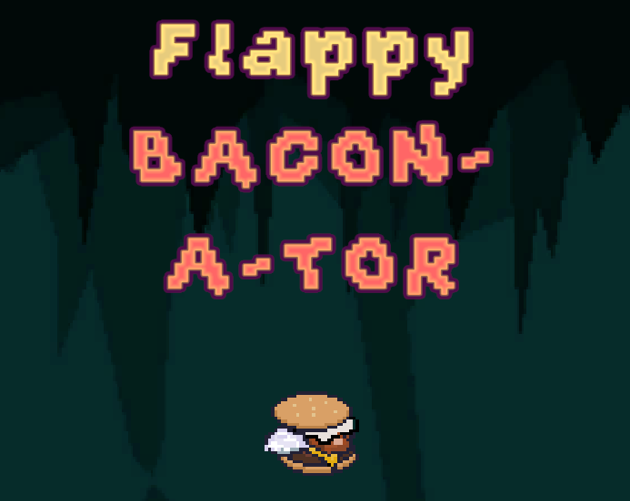
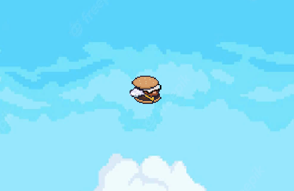
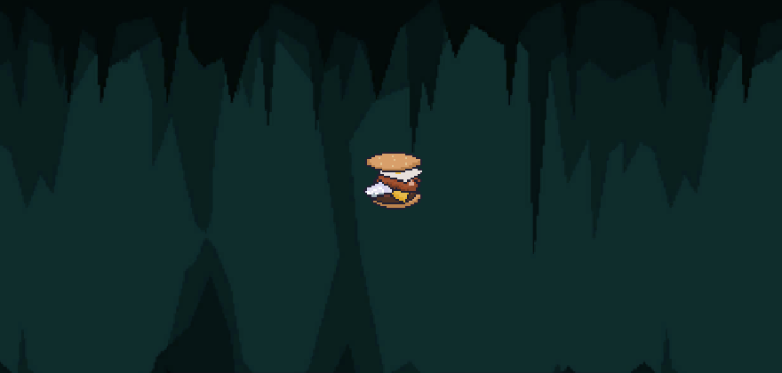
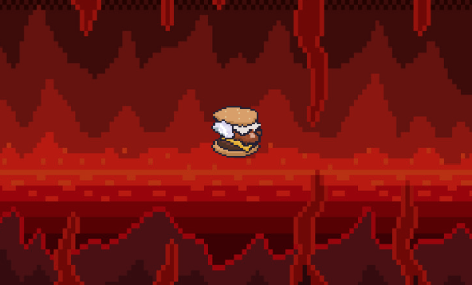

# Flappy Burger (*Flappy BACON-A-TOR*)

A Flappy Bird-inspired 2D arcade game made in **Unity 6 (`6000.0.85f2`)** by **Tamal Rosita**, starring a winged burger navigating scrolling cave pipes across three switchable themes.

> **Play Now on itch.io:** https://tamalrosita.itch.io/flappy-bacon-a-tor
> **Homepage & Docs:** https://tamalrosita.com/FlappyBurger/ ([`docs/index.md`](docs/index.md))

## Features

- **One-button gameplay**: Tap, left-click, or press `Space` to start and flap.
- **Three selectable visual themes**: **Heaven**, **Darkness**, and **Inferno** (`ScriptableObject` skins persisted via `PlayerPrefs`).
- **Scrolling background & DoomFire hazard strip**: Custom `Custom/Sprite Scrolling` shader plus fixed-grid `DoomFireRenderer` (`Assets/DoomFire/DoomFireRenderer.cs`) with `Custom/DoomFire` LUT shader.
- **Inspector-driven tuning**: Gravity, jump force, spawn interval, pipe gap distance, and obstacle speed are all exposed in the Inspector (`NaughtyAttributes` buttons included).
- **Multi-platform ready**: Configured for Android (`com.tamalrosita.flappyburger`), iOS (`com.Aestial.FlappyBurger`), and WebGL (PWA).

### Roadmap / Work in Progress

- [ ] Music system & "Now Playing" toast via [`Aestial/Unity-OpenMusicPlayer`](https://github.com/Aestial/Unity-OpenMusicPlayer) *(see [Plan 002](docs/plans/002-pooling-highscore-and-music-player.md))*
- [ ] Object pooling integration (`Pool.cs` in `Assets/Scripts/Models/Pool.cs`)
- [ ] Persistent high-score storage (`PlayerPrefs`)
- [ ] Health bar UI (`HealthMeter.cs`, deferred) & dedicated flight/death animations

## Themes

| Heaven | Darkness | Inferno |
| :---: | :---: | :---: |
|  |  |  |

## Quick Start

1. Open the project with **Unity `6000.0.85f2`**.
2. Open `Assets/Scenes/Main.unity` (Menu & Skins) or `Assets/Scenes/Game.unity` (Gameplay).
3. Switch the Game view to a **portrait** aspect ratio (e.g., `9:16` or `360x640`) and press **Play**.

## Documentation & Legal

- [Overview](docs/index.md)
- [Technical Architecture & Script Reference](docs/architecture.md)
- [Setup, Customization & Builds](docs/getting-started.md)
- [Development Plans & Decision Log](docs/plans/index.md)
- [Privacy Policy](docs/privacy.md)
- [Terms & Conditions](docs/terms.md)